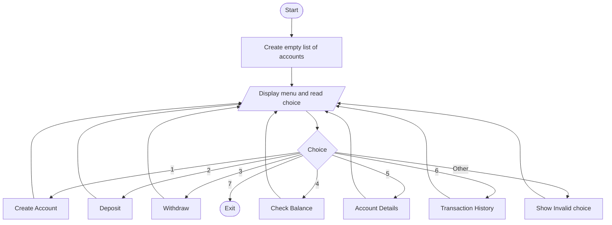
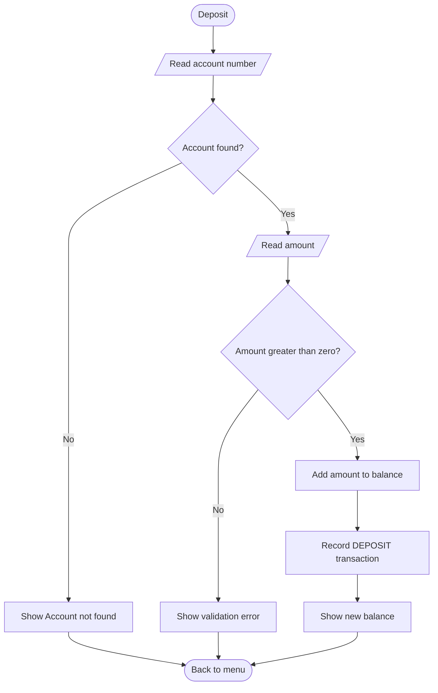
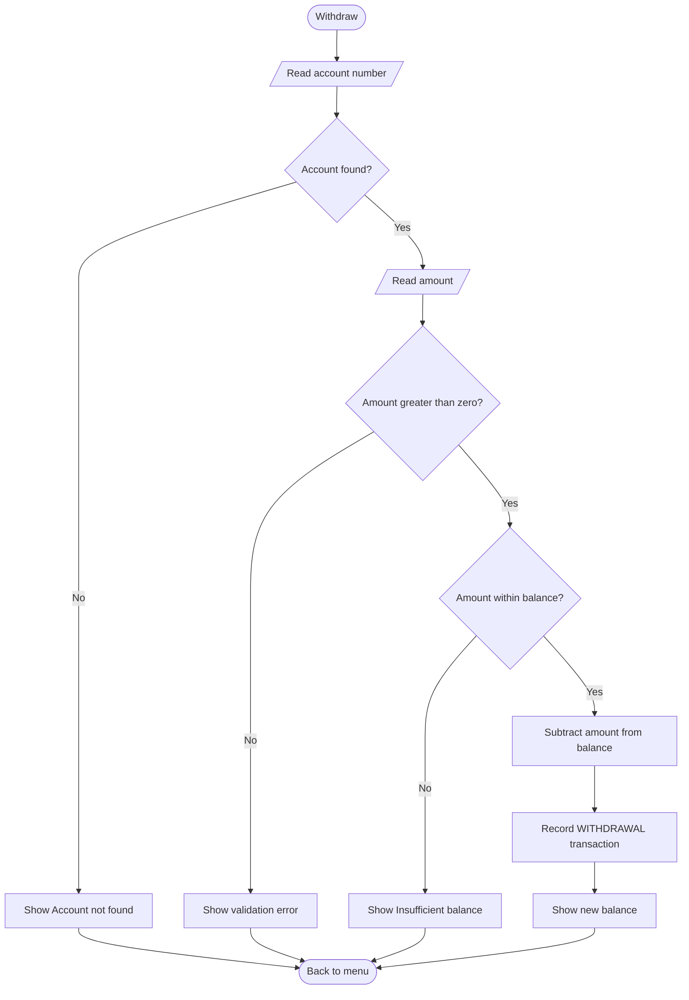

# Bank Management System

A console-based Java application for managing customer bank accounts: create accounts, deposit, withdraw, check balances and keep a full transaction history.

| | |
|---|---|
| **Developer** | Aliyan Ahmad |
| **Program** | Auspify Java Developer Internship |
| **Task** | Task 4 (Medium) - Bank Management System |
| **Language** | Java (JDK 8 or higher) |
| **Storage** | `ArrayList<Account>` (in-memory) |

---

## 1. Objective
Build a banking system that manages customer accounts with correct business rules, validated transactions and a complete transaction history, while demonstrating Object-Oriented Design, Data Validation and Business Logic implementation.

## 2. Features

| # | Feature | Description |
|---|---|---|
| 1 | Create Account | Opens an account with an auto-generated unique account number |
| 2 | Deposit | Adds money to an account |
| 3 | Withdraw | Removes money, only if the balance is sufficient |
| 4 | Check Balance | Shows the current balance |
| 5 | Account Details | Shows account number, holder, balance and transaction count |
| 6 | Transaction History | Lists every successful transaction with date, type, amount and balance after |
| 7 | Exit | Closes the program |

## 3. Requirements Mapping

| Task Step | Requirement | Implementation |
|---|---|---|
| Step 1 | Account class (account no, balance) | `Account.java` |
| Step 2 | Deposit and withdrawal | `Account.deposit()` and `Account.withdraw()` |
| Step 3 | Show account details | `showAccountDetails()` and `checkBalance()` |
| Step 4 | Validate transactions | `Account.validateAmount()`, balance check in `withdraw()`, input helpers |
| Step 5 | Maintain transaction history | `Transaction.java` and the `transactions` list inside `Account` |

## 4. Business Rules

| Rule | Enforced where |
|---|---|
| Account holder name cannot be empty | `Account` constructor |
| Initial deposit must be 0 or more | `Account` constructor |
| Deposit and withdrawal amounts must be greater than zero | `Account.validateAmount()` |
| Withdrawal cannot exceed the current balance (balance never goes negative) | `Account.withdraw()` |
| Account numbers are unique, automatic and start at 1001 | `Account.nextAccountNo` |
| Every successful transaction is recorded; failed ones are not | `Account.deposit()` / `withdraw()` |
| History cannot be edited from outside the `Account` class | Read-only list + immutable `Transaction` |

## 5. Skills Demonstrated
- **Object-Oriented Design:** three cooperating classes, encapsulation, immutable fields (`final`), an `enum`, composition (an account has many transactions)
- **Data Validation:** validation in the model (business rules) and in the input helpers (format), plus exception handling
- **Business Logic:** deposit and withdrawal rules, balance protection, audit trail of transactions
- **Collections:** `ArrayList`, `unmodifiableList`

## 6. Project Structure
```
Bank-Management-System/
|-- Transaction.java          (immutable transaction record)
|-- Account.java              (account data + business logic)
|-- Bankmanagement.java (main class: menu + user interaction)
|-- README.md                 (this document)
```

## 7. Class Design

```
Transaction                      Account                              Bankmanagement
---------------------------      ---------------------------------    -------------------------------
- type : Type (enum)             - nextAccountNo : int (static)       - accounts : ArrayList<Account>
- amount : double                - accountNo : int (final)            - sc : Scanner
- balanceAfter : double          - holderName : String (final)        -------------------------------
- timestamp : LocalDateTime      - balance : double                   + main()
---------------------------      - transactions : ArrayList           - menu()
+ Transaction(type, amt, bal)    ---------------------------------    - createAccount()
+ getters                        + Account(name, initialDeposit)      - deposit() / withdraw()
+ tableHeader() : String         + getAccountNo() / getHolderName()   - checkBalance()
+ toString()                     + getBalance()                       - showAccountDetails()
                                 + getTransactionHistory()            - showTransactionHistory()
Type: OPENING_DEPOSIT,           + deposit(amount)                    - askForAccount()
      DEPOSIT, WITHDRAWAL        + withdraw(amount)                   - findByAccountNo(no)
                                 - validateAmount(amount)             - readAmount
```

**Relationships**
- `Bankmanagement` has many `Account` objects.
- `Account` has many `Transaction` objects (composition).

**Design decisions**
- **Business logic lives in `Account`, not in the menu code.** The rules are enforced no matter how the account is used.
- **The balance has no setter.** It can only change through `deposit()` and `withdraw()`, so every change is validated and recorded.
- **`Transaction` is immutable.** A recorded transaction can never be altered, like a real bank statement.
- **Errors are signalled with exceptions.** `IllegalArgumentException` is used for invalid input values, and `IllegalStateException` for insufficient balance. The menu code catches them and prints a clear message.
- **Account numbers are generated automatically,** so duplicates are impossible.
- **All input uses `nextLine()` plus manual parsing,** which avoids the Scanner newline bug.

## 8. Pseudocode

```
START
  CREATE empty list accounts
  SET nextAccountNo = 1001

  REPEAT
    DISPLAY menu
    READ choice

    CASE 1 - CREATE ACCOUNT:
        READ name
        READ initial deposit (must be a valid number, otherwise ask again)
        IF name is empty OR initial deposit is negative THEN
            DISPLAY error
        ELSE
            CREATE Account with nextAccountNo; INCREMENT nextAccountNo
            IF initial deposit > 0 THEN record OPENING_DEPOSIT transaction
            ADD account to accounts
            DISPLAY account number

    CASE 2 - DEPOSIT:
        account = ASK FOR ACCOUNT
        IF account found THEN
            READ amount
            IF amount <= 0 THEN DISPLAY "Amount must be greater than zero"
            ELSE
                balance = balance + amount
                RECORD DEPOSIT transaction
                DISPLAY new balance

    CASE 3 - WITHDRAW:
        account = ASK FOR ACCOUNT
        IF account found THEN
            READ amount
            IF amount <= 0 THEN DISPLAY "Amount must be greater than zero"
            ELSE IF amount > balance THEN DISPLAY "Insufficient balance"
            ELSE
                balance = balance - amount
                RECORD WITHDRAWAL transaction
                DISPLAY new balance

    CASE 4 - CHECK BALANCE:
        account = ASK FOR ACCOUNT
        IF account found THEN DISPLAY balance

    CASE 5 - ACCOUNT DETAILS:
        account = ASK FOR ACCOUNT
        IF account found THEN DISPLAY number, holder, balance, transaction count

    CASE 6 - TRANSACTION HISTORY:
        account = ASK FOR ACCOUNT
        IF account found THEN
            IF history is empty THEN DISPLAY "No transactions yet"
            ELSE FOR EACH transaction IN history: DISPLAY it

    CASE 7 - EXIT:
        DISPLAY "Goodbye"; STOP loop

    OTHERWISE:
        DISPLAY "Invalid choice"
  UNTIL user chooses Exit
END

FUNCTION ASK FOR ACCOUNT:
    READ account number
    IF input is not a whole number THEN DISPLAY error; RETURN null
    FOR EACH account IN accounts
        IF account.accountNo == number THEN RETURN account
    DISPLAY "Account not found"
    RETURN null
```

## 9. Flowcharts

### 9.1 Main program flow


### 9.2 Deposit


### 9.3 Withdraw


Check Balance, Account Details and Transaction History follow the same opening pattern: read the account number, stop with an error if not found, otherwise display the result.

## 10. How to Compile and Run

```
javac Transaction.java Account.java Bankmanagement.java
java Bankmanagement
```

## 11. Sample Output

```
===== WELCOME TO THE BANK MANAGEMENT SYSTEM =====
1. Create Account
2. Deposit
3. Withdraw
4. Check Balance
5. Account Details
6. Transaction History
7. Exit
Enter Your Choice: 1
Account Holder Name: Aliyan
Enter the Initial Deposit Amount: 5000

[SUCCESS] Account Created Successfully.
Your Account Number is: 1001

Enter Your Choice: 3
Enter Account Number: 1001
Enter the amount to withdraw: 1200
[SUCCESS] Withdrawal Successful.
Current Balance: 3800.00

Enter Your Choice: 6
Enter Account Number: 1001

Transaction history for account 1001 (Aliyan)
| Date & Time         | Type            |       Amount | Balance After  |
|---------------------|-----------------|--------------|----------------|
| 2026-10-06 14:30:12 | OPENING_DEPOSIT |      5000.00 |        5000.00 |
| 2026-10-06 14:31:45 | WITHDRAWAL      |      1200.00 |        3800.00 |
Total transactions: 2
```

## 12. Test Cases

| # | Feature | Input | Expected result |
|---|---|---|---|
| 1 | Create | Name "Aliyan", deposit 5000 | Account 1001 created |
| 2 | Create | Second account, deposit 0 | Account 1002 created, no history yet |
| 3 | Create | Empty name | "[ERROR] Account holder name cannot be empty.", back to menu |
| 4 | Create | Deposit -100 | "[ERROR] Initial deposit cannot be negative.", back to menu |
| 5 | Create | Deposit abc | "Invalid input. Please enter a number.", asks again |
| 6 | Deposit | 1001, amount 500 | Balance 5500.00 |
| 7 | Deposit | 1001, amount 0 | "[ERROR] Amount must be greater than zero." |
| 8 | Deposit | 1001, amount -50 | "[ERROR] Amount must be greater than zero." |
| 9 | Deposit | Account 9999 | "[ERROR] Account 9999 not found." |
| 10 | Deposit | Amount abc | "Invalid input. Please enter a number.", asks again |
| 11 | Withdraw | 1001, amount 1000 | Balance reduced by 1000 |
| 12 | Withdraw | Amount greater than balance | "[ERROR] Insufficient balance. Available: ...", balance unchanged |
| 13 | Withdraw | Amount equal to the full balance | Succeeds, balance becomes 0.00 |
| 14 | Withdraw | Amount -10 | "[ERROR] Amount must be greater than zero." |
| 15 | Balance | 1001 | Current balance shown |
| 16 | Details | 1001 | Number, holder, balance and transaction count shown |
| 17 | History | 1001 after several transactions | All successful transactions listed in order |
| 18 | History | Account with no transactions (test 2) | "No Transactions Found..." |
| 19 | History | After a failed withdrawal | Failed attempt does not appear |
| 20 | Any account prompt | abc | "[ERROR] Invalid Account Number format.", back to menu |
| 21 | Menu | abc | "Invalid input. Please enter a number." |
| 22 | Menu | Choice 9 | "Invalid choice. Please enter a number from 1 to 7." |
| 23 | Menu | Choice 7 | Program exits |

## 13. Known Limitations
- Data is stored in memory only and is lost when the program closes.
- Money is stored as `double`, which is fine for learning, but production banking software uses `BigDecimal` to avoid rounding errors.
- There is no login, PIN or authentication.
- Amounts with more than two decimal places (for example 10.005) are accepted and only rounded when displayed.
- Account lookup is a linear scan, which is fine for small data sets.

## 14. Future Enhancements
- Transfer money between two accounts
- PIN-based login and a minimum balance rule
- Use `BigDecimal` for exact money calculations and reject amounts with more than two decimal places
- Save and load accounts from a file (File I/O) or a database (JDBC)
- Use a `HashMap<Integer, Account>` for faster lookup
- Add unit tests with JUnit
- Convert to a GUI or Spring Boot REST API
